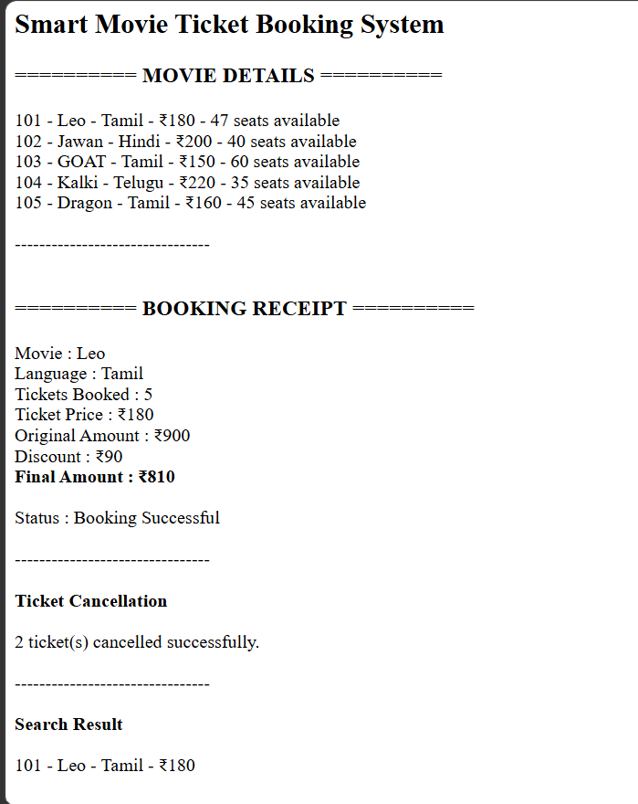
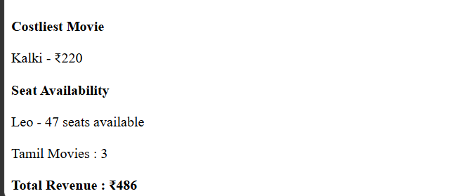

# Day 53 - JavaScript Smart Movie Ticket Booking System

## Overview

Created a Smart Movie Ticket Booking System using HTML and JavaScript to manage movies, ticket bookings, cancellations, seat availability, movie search, and revenue tracking.

## Topics Covered

- JavaScript Classes
- Constructor and Objects
- Arrays
- Loops
- Conditional Statements
- Ticket Booking and Cancellation
- Discount Calculation
- Seat Management
- Movie Search
- Revenue Calculation
- DOM Manipulation

## Technologies Used

- HTML5
- JavaScript

## Practice

Performed the following operations:

- Stored movie details
- Displayed movie information
- Booked movie tickets
- Calculated ticket prices and discounts
- Updated available seats
- Cancelled tickets and calculated refunds
- Searched movies by name
- Found the costliest movie
- Checked seat availability
- Counted movies by language
- Calculated total revenue

## JavaScript Concepts Used

- `class`
- `constructor()`
- `this`
- Arrays
- `for` loop
- `if-else`
- Logical Operators
- Object Literals
- Functions
- `push()`
- `toLowerCase()`
- `includes()`
- `Math.min()`
- Template Literals
- `getElementById()`
- `innerHTML`

## Output

## Learning Outcome

Learned how to manage movie bookings, ticket cancellations, refunds, seat availability, discounts, and revenue using JavaScript classes, arrays, loops, and conditional statements.
