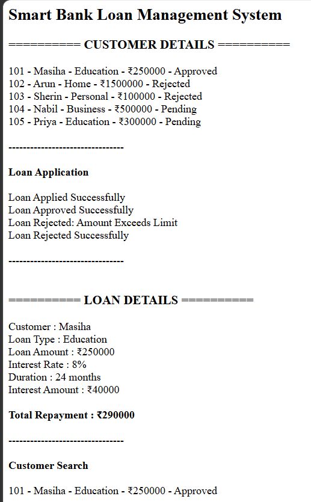
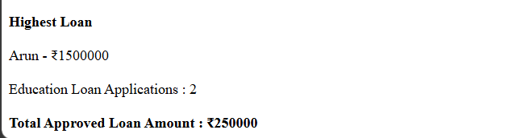

# Day 54 - JavaScript Smart Bank Loan Management System

## Overview

Created a Smart Bank Loan Management System using HTML and JavaScript to manage loan applications, approvals, rejections, interest calculations, customer searches, and loan tracking.

## Topics Covered

- JavaScript Classes
- Constructor and Objects
- Arrays
- Loops
- Conditional Statements
- Loan Application Management
- Loan Approval and Rejection
- Interest Calculation
- Customer Search
- Loan Amount Tracking
- DOM Manipulation

## Technologies Used

- HTML5
- JavaScript

## Practice

Performed the following operations:

- Stored customer and loan details
- Displayed customer information
- Applied for loans
- Approved or rejected loan applications
- Checked loan amount limits
- Calculated interest and total repayment
- Searched customers by name
- Found the highest loan amount
- Calculated the total approved loan amount
- Counted loan applications by type

## JavaScript Concepts Used

- `class`
- `constructor()`
- `this`
- Arrays
- `for` loop
- `if-else`
- Object Literals
- Functions
- `toLowerCase()`
- `includes()`
- Template Literals
- Arithmetic Operators
- `getElementById()`
- `innerHTML`

## Output

## Learning Outcome

Learned how to manage loan applications, process approvals and rejections, calculate interest, search customer records, and track approved loan amounts using JavaScript classes, arrays, loops, and conditional statements.
