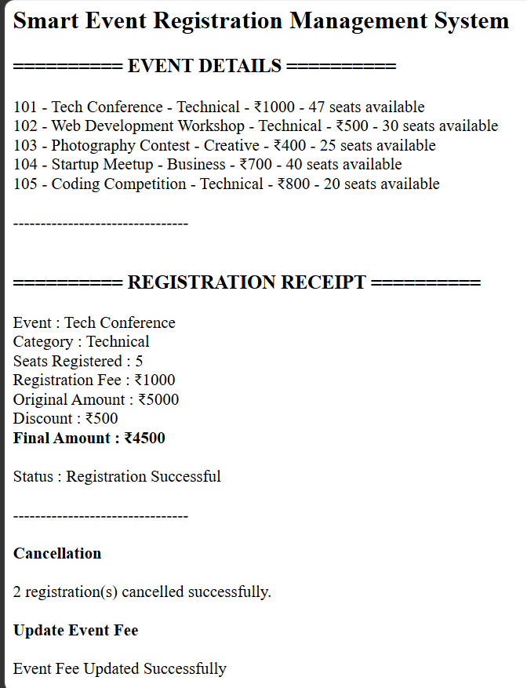
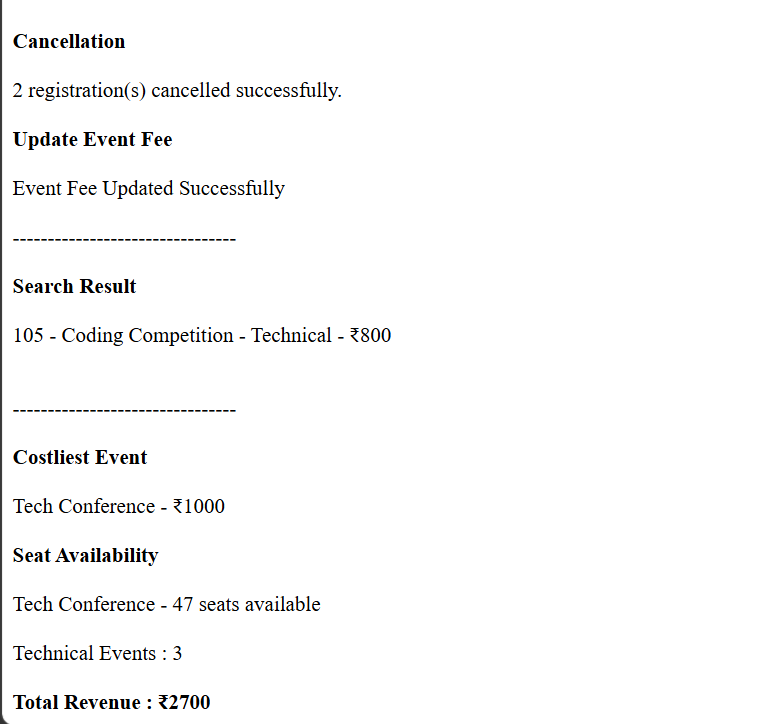

# Day 55 - JavaScript Smart Event Registration Management System

## Overview

Created a Smart Event Registration Management System using HTML and JavaScript to manage events, registrations, cancellations, event searches, seat availability, and revenue tracking.

## Topics Covered

- JavaScript Classes
- Constructor and Objects
- Arrays
- Loops
- Conditional Statements
- Event Registration and Cancellation
- Discount Calculation
- Seat Management
- Event Search
- Fee Updates
- Revenue Calculation
- DOM Manipulation

## Technologies Used

- HTML5
- JavaScript

## Practice

Performed the following operations:

- Stored event details
- Displayed event information
- Registered participants for events
- Calculated registration fees and discounts
- Updated available seats
- Cancelled registrations and calculated refunds
- Updated event registration fees
- Searched events by name
- Found the costliest event
- Checked seat availability
- Counted events by category
- Calculated total revenue

## JavaScript Concepts Used

- `class`
- `constructor()`
- `this`
- Arrays
- `for` loop
- `if-else`
- Logical Operators
- Object Literals
- Functions
- `push()`
- `toLowerCase()`
- `includes()`
- `Math.min()`
- Template Literals
- `getElementById()`
- `innerHTML`

## Output

## Learning Outcome

Learned how to manage event registrations, cancellations, discounts, refunds, seat availability, event fees, and revenue using JavaScript classes, arrays, loops, and conditional statements.
