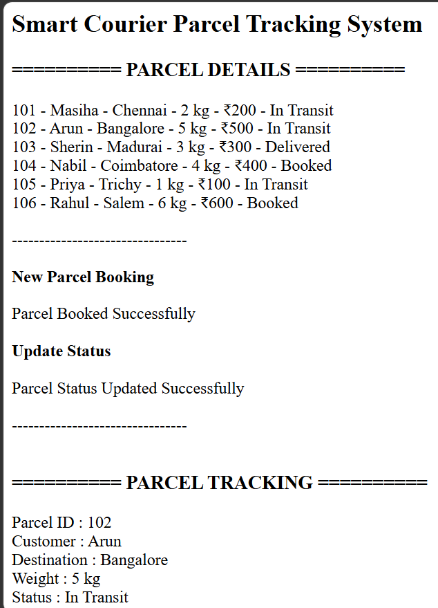
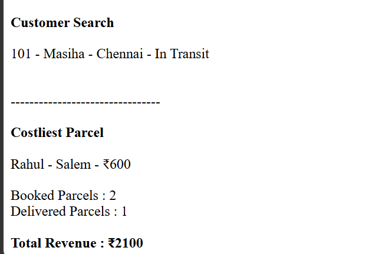

# Day 57 - JavaScript Smart Courier Parcel Tracking System

## Overview

Created a Smart Courier Parcel Tracking System using HTML and JavaScript to manage parcel bookings, track deliveries, update parcel statuses, search customers, and calculate revenue.

## Topics Covered

- JavaScript Classes
- Constructor and Objects
- Arrays
- Loops
- Conditional Statements
- Parcel Booking and Tracking
- Status Management
- Customer Search
- Cost Calculation
- Revenue Tracking
- DOM Manipulation

## Technologies Used

- HTML5
- JavaScript

## Practice

Performed the following operations:

- Stored and displayed parcel details
- Booked new parcels
- Calculated parcel costs based on weight
- Updated parcel delivery statuses
- Tracked parcels using parcel IDs
- Searched parcels by customer name
- Found the costliest parcel
- Counted parcels by status
- Calculated total courier revenue

## JavaScript Concepts Used

- `class`
- `constructor()`
- `this`
- Arrays
- `for` loop
- `if-else`
- Object Literals
- Functions
- `push()`
- `toLowerCase()`
- `includes()`
- Template Literals
- `getElementById()`
- `innerHTML`

## Output

## Learning Outcome

Learned how to manage parcel bookings, track deliveries, update statuses, search customer records, calculate parcel costs, and track revenue using JavaScript classes, arrays, loops, and conditional statements.
