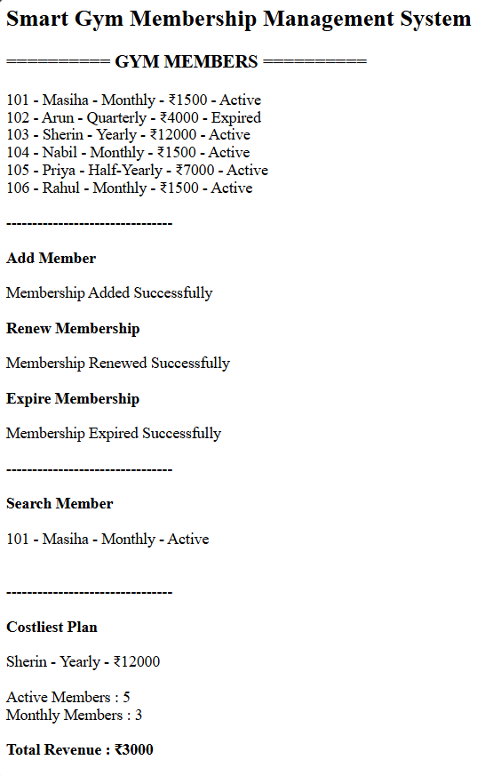

# Day 58 - JavaScript Smart Gym Membership Management System

## Overview

Created a Smart Gym Membership Management System using HTML and JavaScript to manage gym members, memberships, renewals, expirations, member searches, and revenue tracking.

## Topics Covered

- JavaScript Classes
- Constructor and Objects
- Arrays
- Loops
- Conditional Statements
- Membership Management
- Membership Renewal and Expiration
- Member Search
- Plan Comparison
- Revenue Calculation
- CRUD Operations
- DOM Manipulation

## Technologies Used

- HTML5
- JavaScript

## Practice

Performed the following operations:

- Stored and displayed gym member details
- Added new members
- Searched members by name
- Renewed memberships
- Expired memberships
- Found the costliest membership plan
- Counted active members
- Counted members by plan
- Calculated total revenue
- Deleted member records
- Validated membership details and duplicate IDs

## JavaScript Concepts Used

- `class`
- `constructor()`
- `this`
- Arrays
- `for` loop
- `if-else`
- Object Literals
- Functions
- `push()`
- `splice()`
- `toLowerCase()`
- `includes()`
- `getElementById()`
- `innerHTML`

## Output

## Learning Outcome

Learned how to manage gym memberships, track member status, renew and expire plans, search records, compare membership fees, and calculate revenue using JavaScript classes, arrays, loops, and conditional statements.
