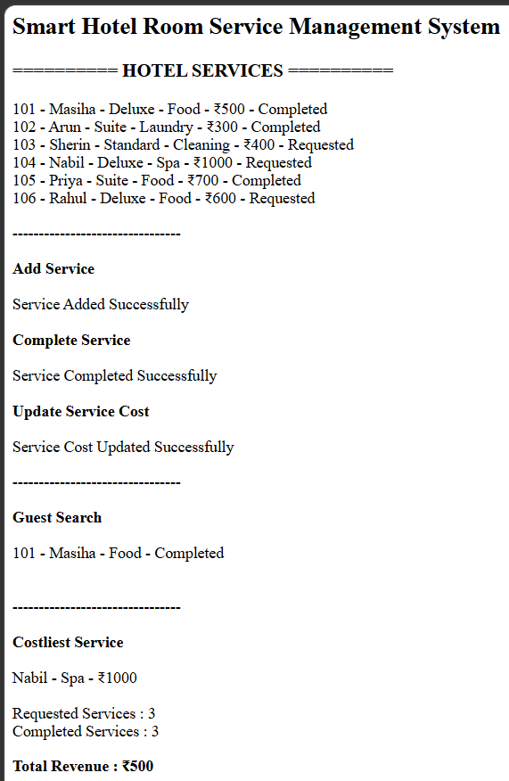

# Day 59 - JavaScript Smart Hotel Room Service Management System

## Overview

Created a Smart Hotel Room Service Management System using HTML and JavaScript to manage guest services, service completion, guest searches, service cost updates, and revenue tracking.

## Topics Covered

- JavaScript Classes
- Constructor and Objects
- Arrays
- Loops
- Conditional Statements
- Room Service Management
- Service Completion
- Guest Search
- Cost Management
- Status Tracking
- Revenue Calculation
- DOM Manipulation

## Technologies Used

- HTML5
- JavaScript

## Practice

Performed the following operations:

- Stored and displayed hotel service details
- Added new room services
- Completed requested services
- Updated service costs
- Searched services by guest name
- Found the costliest service
- Counted requested and completed services
- Calculated total revenue
- Validated room IDs and service costs

## JavaScript Concepts Used

- `class`
- `constructor()`
- `this`
- Arrays
- `for` loop
- `if-else`
- Object Literals
- Functions
- `push()`
- `toLowerCase()`
- `includes()`
- `getElementById()`
- `innerHTML`

## Output

## Learning Outcome

Learned how to manage hotel room services, update service costs and statuses, search guest records, track completed services, and calculate revenue using JavaScript classes, arrays, loops, and conditional statements.
