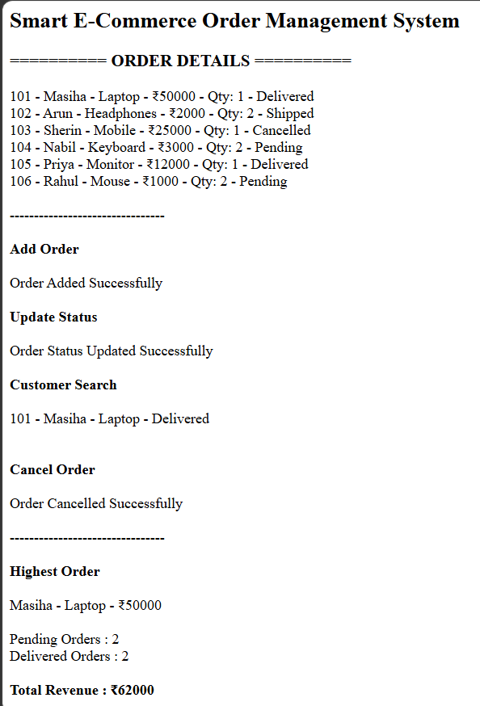

# Day 60 - JavaScript Smart E-Commerce Order Management System

## Overview

Created a Smart E-Commerce Order Management System using HTML and JavaScript to manage customer orders, update statuses, cancel orders, search customers, and track revenue.

## Topics Covered

- JavaScript Classes
- Constructor and Objects
- Arrays
- Loops
- Conditional Statements
- Order Management
- Order Cancellation
- Customer Search
- Status Tracking
- Revenue Calculation
- CRUD Operations
- DOM Manipulation

## Technologies Used

- HTML5
- JavaScript

## Practice

Performed the following operations:

- Stored and displayed order details
- Added new orders
- Updated order statuses
- Searched orders by customer name
- Cancelled orders
- Found the highest-value order
- Counted orders by status
- Calculated revenue from delivered orders
- Deleted order records
- Validated order IDs, prices, and quantities

## JavaScript Concepts Used

- `class`
- `constructor()`
- `this`
- Arrays
- `for` loop
- `if-else`
- Logical Operators
- Object Literals
- Functions
- `push()`
- `splice()`
- `toLowerCase()`
- `includes()`
- `getElementById()`
- `innerHTML`

## Output

## Learning Outcome

Learned how to manage e-commerce orders, track delivery statuses, handle cancellations, search customer records, calculate order values, and track revenue using JavaScript classes, arrays, loops, and conditional statements.
