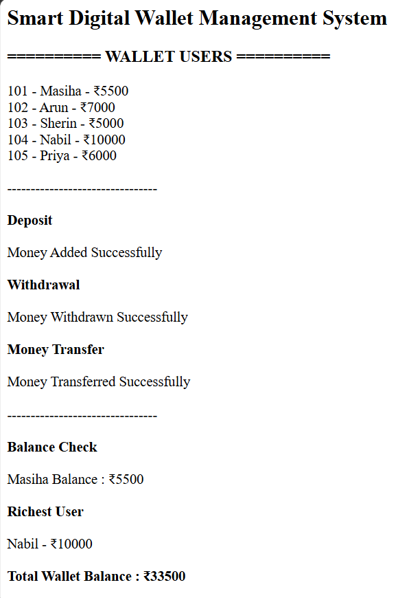
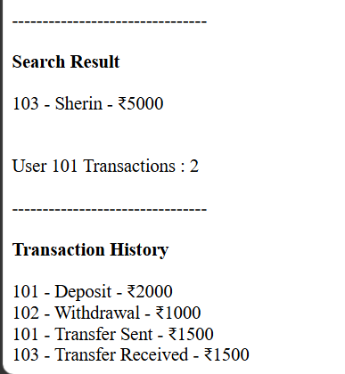

# Day 61 - JavaScript Smart Digital Wallet Management System

## Overview

Created a Smart Digital Wallet Management System using HTML and JavaScript to manage wallet balances, deposits, withdrawals, money transfers, user searches, and transaction history.

## Topics Covered

- JavaScript Classes
- Constructor and Objects
- Arrays
- Loops
- Conditional Statements
- Digital Wallet Management
- Deposit and Withdrawal Operations
- Money Transfer
- Balance Tracking
- Transaction History
- User Search
- DOM Manipulation

## Technologies Used

- HTML5
- JavaScript

## Practice

Performed the following operations:

- Stored and displayed wallet user details
- Added money to user wallets
- Withdrawn money with balance validation
- Transferred money between users
- Checked wallet balances
- Found the richest user
- Calculated total wallet balance
- Searched users by name
- Counted user transactions
- Displayed transaction history
- Validated amounts and user IDs

## JavaScript Concepts Used

- `class`
- `constructor()`
- `this`
- Arrays
- `for` loop
- `if-else`
- Logical Operators
- Object Literals
- Functions
- `push()`
- `toLowerCase()`
- `includes()`
- `getElementById()`
- `innerHTML`

## Output

## Learning Outcome

Learned how to manage digital wallet balances, perform deposits and withdrawals, transfer money securely, maintain transaction records, and search users using JavaScript classes, arrays, loops, and conditional statements.
