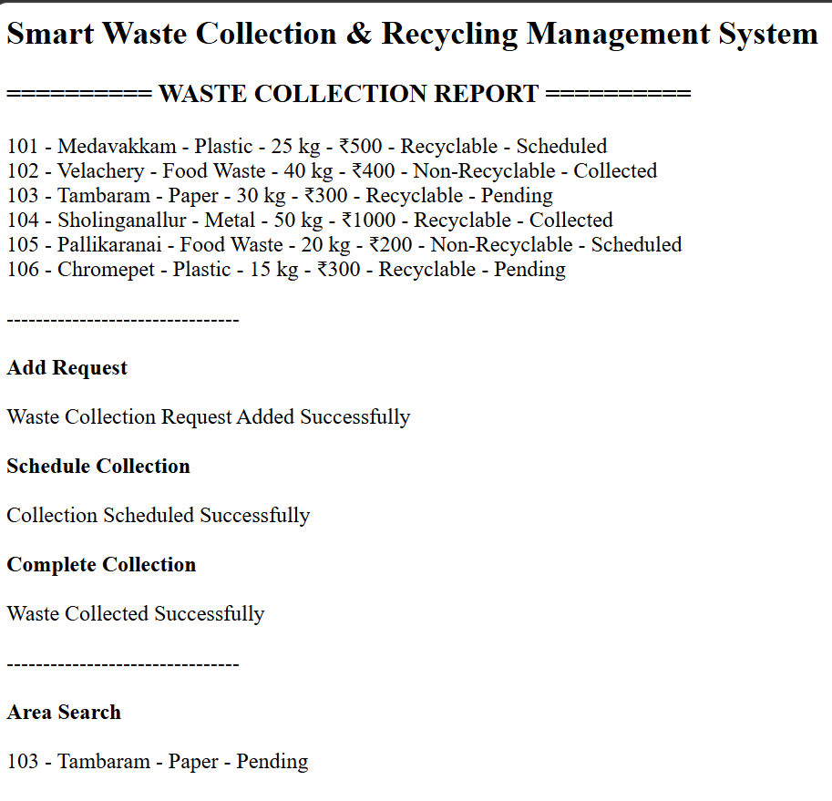
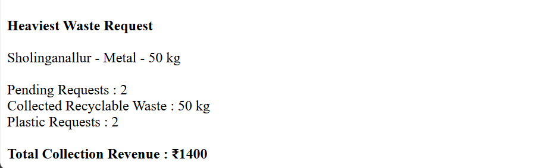

# Day 62 - JavaScript Smart Waste Collection and Recycling Management System

## Overview

Created a Smart Waste Collection and Recycling Management System using HTML and JavaScript to manage waste collection requests, schedule pickups, track collection status, identify recyclable waste, and calculate revenue.

## Topics Covered

- JavaScript Classes
- Constructor and Objects
- Arrays
- Loops
- Conditional Statements
- Waste Collection Management
- Collection Scheduling
- Recycling Management
- Area-Based Search
- Waste Weight Analysis
- Status Tracking
- Revenue Calculation
- DOM Manipulation

## Technologies Used

- HTML5
- JavaScript

## Practice

Performed the following operations:

- Stored and displayed waste collection requests
- Added new collection requests
- Scheduled waste collections
- Completed scheduled collections
- Searched requests by area
- Found the heaviest waste collection request
- Counted pending requests
- Calculated collected recyclable waste weight
- Counted requests by waste type
- Calculated total collection revenue
- Validated request IDs, waste weight, and collection fees

## JavaScript Concepts Used

- `class`
- `constructor()`
- `this`
- Arrays
- `for` loop
- `if-else`
- Logical Operators
- Object Literals
- Functions
- `push()`
- `toLowerCase()`
- `includes()`
- Arithmetic Operators
- `getElementById()`
- `innerHTML`

## Output

## Learning Outcome

Learned how to manage waste collection requests, schedule pickups, track collection statuses, monitor recyclable waste, search by area, and calculate collection revenue using JavaScript classes, arrays, loops, and conditional statements.
