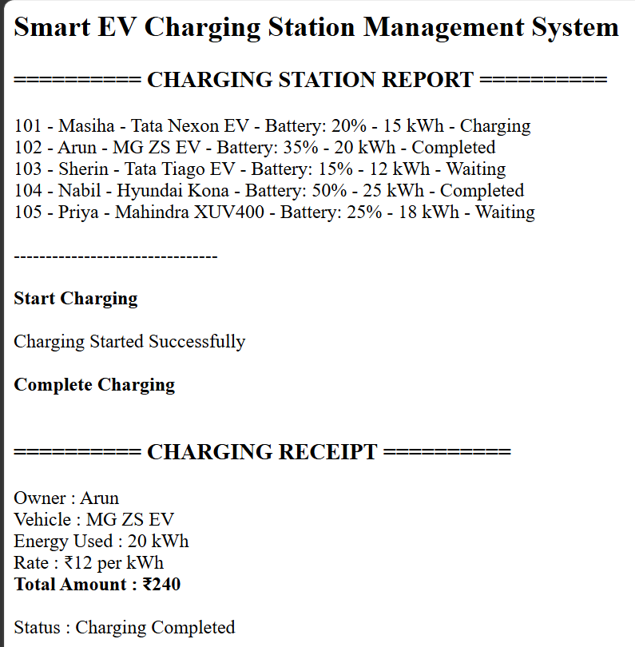
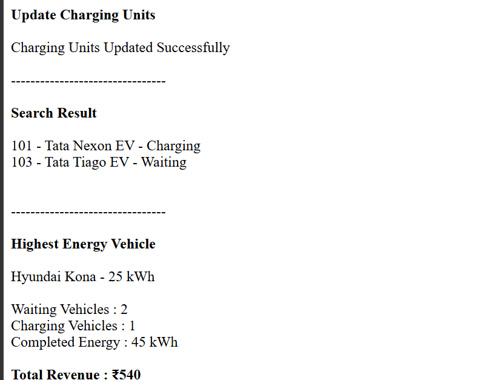

# Day 63 - JavaScript Smart EV Charging Station Management System

## Overview

Created a Smart EV Charging Station Management System using HTML and JavaScript to manage electric vehicles, charging operations, energy consumption, vehicle searches, and revenue tracking.

## Topics Covered

- JavaScript Classes
- Constructor and Objects
- Arrays
- Loops
- Conditional Statements
- EV Charging Management
- Charging Status Tracking
- Energy Consumption Calculation
- Vehicle Search
- Charging Cost Calculation
- Revenue Tracking
- DOM Manipulation

## Technologies Used

- HTML5
- JavaScript

## Practice

Performed the following operations:

- Stored and displayed electric vehicle details
- Started vehicle charging
- Completed charging and generated receipts
- Updated charging energy units
- Searched vehicles by name
- Found the vehicle with the highest energy requirement
- Counted vehicles by charging status
- Calculated total completed energy consumption
- Calculated total charging revenue
- Validated charging status and energy units

## JavaScript Concepts Used

- `class`
- `constructor()`
- `this`
- Arrays
- `for` loop
- `if-else`
- Object Literals
- Functions
- `toLowerCase()`
- `includes()`
- Template Literals
- Arithmetic Operators
- `getElementById()`
- `innerHTML`

## Output

## Learning Outcome

Learned how to manage EV charging operations, track vehicle statuses, calculate energy consumption and charging costs, generate receipts, and monitor revenue using JavaScript classes, arrays, loops, and conditional statements.
