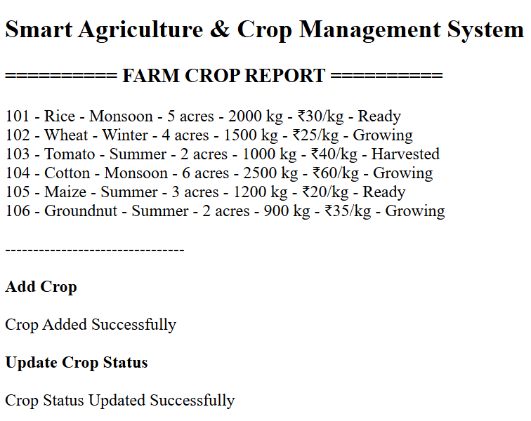
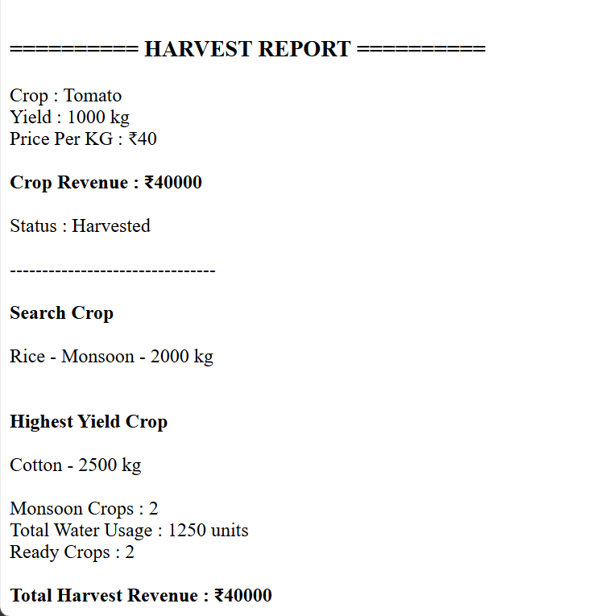

# Day 64 - JavaScript Smart Agriculture & Crop Management System

## Overview

Created a Smart Agriculture & Crop Management System using HTML and JavaScript to manage crops, track growing seasons, update crop statuses, calculate harvest revenue, monitor water usage, and analyze crop yields.

## Topics Covered

- JavaScript Classes
- Constructor and Objects
- Arrays
- Loops
- Conditional Statements
- Crop Management
- Crop Status Updates
- Harvest Revenue Calculation
- Crop Search
- Seasonal Crop Analysis
- Water Usage Calculation
- Yield Analysis
- DOM Manipulation

## Technologies Used

- HTML5
- JavaScript

## Practice

Performed the following operations:

- Displayed all crop details
- Added new crops with validation
- Prevented duplicate crop IDs
- Searched crops by name
- Updated crop statuses
- Generated harvest reports
- Calculated crop revenue
- Identified the highest-yielding crop
- Counted crops by season
- Calculated total water usage
- Counted crops ready for harvest
- Calculated total harvest revenue

## JavaScript Concepts Used

- `class`
- `constructor()`
- `this`
- Arrays
- `for` loop
- `if-else`
- Logical Operators
- Object Literals
- Template Literals
- Functions and Methods
- `push()`
- `toLowerCase()`
- `includes()`
- Arithmetic Operators
- `getElementById()`
- `innerHTML`

## Output

## Learning Outcome

Learned how to manage crop details, track crop growth, analyze seasonal crops, calculate water usage, identify the highest-yielding crop, and generate harvest revenue reports using JavaScript classes, arrays, loops, and conditional statements.
