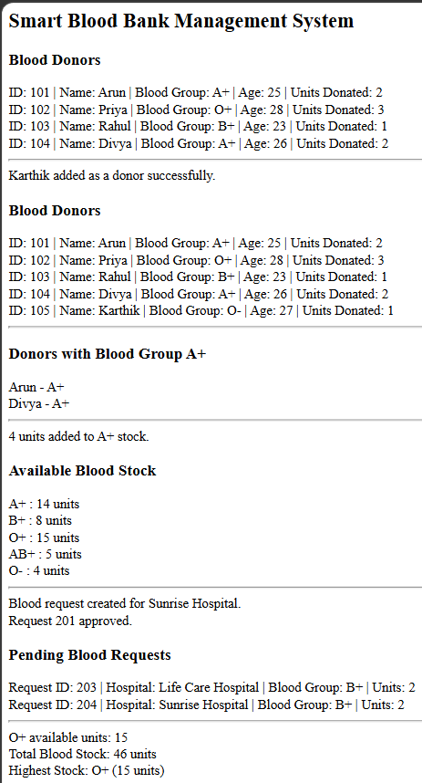

# Day 66 - JavaScript Smart Blood Bank Management System

## Overview

Created a Smart Blood Bank Management System using HTML and JavaScript to manage blood donors, maintain blood stock, handle hospital blood requests, approve requests, and track blood availability.

## Topics Covered

- JavaScript Classes
- Constructor and Objects
- Arrays
- Loops
- Conditional Statements
- Blood Donor Management
- Blood Stock Management
- Blood Group Search
- Hospital Blood Requests
- Request Approval
- Blood Availability Checking
- Pending Request Tracking
- Stock Analysis
- DOM Manipulation

## Technologies Used

- HTML5
- JavaScript

## Practice

Performed the following operations:

- Displayed all blood donor details
- Added new blood donors
- Searched donors by blood group
- Added units to existing blood stock
- Created hospital blood requests
- Approved pending blood requests
- Checked blood availability by blood group
- Calculated total blood stock
- Displayed pending blood requests
- Identified the blood group with the highest stock

## JavaScript Concepts Used

- `class`
- `constructor()`
- `this`
- Arrays
- `for` loop
- `if-else`
- Conditional Statements
- Object Literals
- Functions and Methods
- `push()`
- Strict Equality (`===`)
- Arithmetic Operators
- `break`
- `getElementById()`
- `innerHTML`

## Output

## Learning Outcome

Learned how to manage blood donors, maintain blood inventory, process hospital blood requests, check blood availability, and analyze stock levels using JavaScript classes, arrays, loops, and conditional statements.
