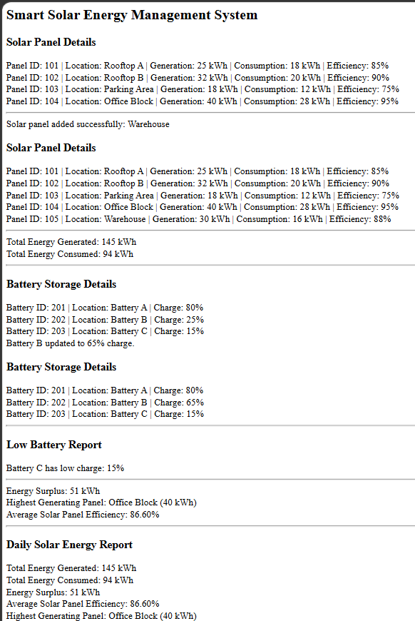

# Day 68 - JavaScript Smart Pet Adoption & Care Management System

## Overview

Created a Smart Pet Adoption & Care Management System using HTML and JavaScript to manage pet details, handle adoptions, track vaccination status, search pets by type, and generate adoption reports.

## Topics Covered

- JavaScript Classes
- Constructor and Objects
- Arrays
- Loops
- Conditional Statements
- Pet Management
- Pet Adoption Tracking
- Vaccination Status Management
- Pet Search by Type
- Adoption Records
- Pet Age Analysis
- Adoption Report Generation
- DOM Manipulation

## Technologies Used

- HTML5
- JavaScript

## Practice

Performed the following operations:

- Displayed all pet details
- Added new pets
- Searched pets by type
- Adopted available pets
- Prevented adoption of already adopted pets
- Displayed available pets
- Updated vaccination status
- Counted adopted pets
- Counted available pets
- Identified the oldest pet
- Displayed adoption records
- Generated a pet adoption report
- Counted vaccinated pets

## JavaScript Concepts Used

- `class`
- `constructor()`
- `this`
- Arrays
- `for` loop
- `if-else`
- Strict Equality (`===`)
- Ternary Operator
- Object Literals
- Functions and Methods
- `push()`
- `toLowerCase()`
- `getElementById()`
- `innerHTML`

## Output

## Learning Outcome

Learned how to manage pet records, process adoptions, track vaccinations, identify the oldest pet, maintain adoption records, and generate reports using JavaScript classes, arrays, loops, and conditional statements.
