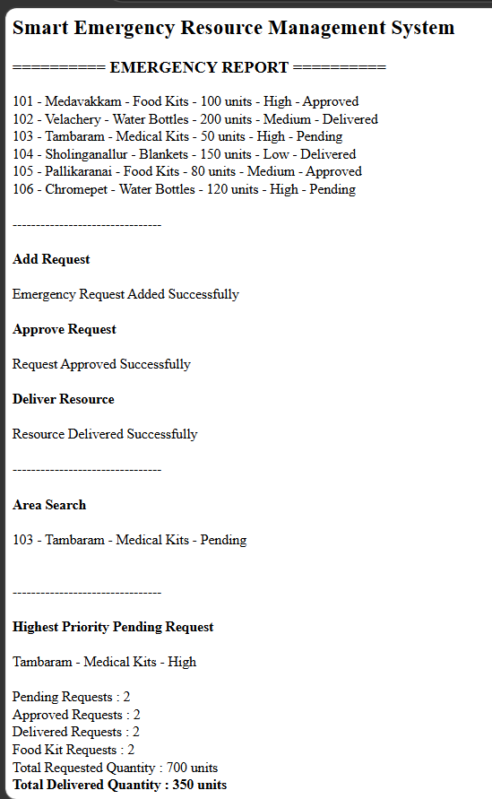

# Day 69 - JavaScript Smart Blood Bank Management System

## Overview

Created a Smart Blood Bank Management System using HTML and JavaScript to manage blood stock, donor details, blood donations, patient blood requests, and generate blood bank reports.

## Topics Covered

- JavaScript Classes
- Constructor and Objects
- Arrays
- Loops
- Conditional Statements
- Blood Stock Management
- Donor Management
- Blood Donation Tracking
- Blood Request Management
- Blood Availability Checking
- Blood Group Search
- Donation Records
- Blood Bank Report Generation
- DOM Manipulation

## Technologies Used

- HTML5
- JavaScript

## Practice

Performed the following operations:

- Displayed blood stock details
- Added new blood donors
- Prevented duplicate donor IDs
- Validated donor age and blood group
- Displayed donor details
- Searched donors by blood group
- Registered blood donations
- Updated blood stock after donations
- Processed patient blood requests
- Checked blood availability
- Prevented requests when stock was insufficient
- Identified the blood group with the highest stock
- Counted donors by blood group
- Calculated total available blood units
- Displayed donation records
- Generated a blood bank report

## JavaScript Concepts Used

- `class`
- `constructor()`
- `this`
- Arrays
- `for` loop
- Nested Loops
- `if-else`
- Strict Equality (`===`)
- Logical Operators
- Object Literals
- Functions and Methods
- `push()`
- `toLowerCase()`
- `toUpperCase()`
- Arithmetic Operators
- `getElementById()`
- `innerHTML`

## Output

## Learning Outcome

Learned how to manage blood stock, maintain donor details, register donations, process blood requests, check stock availability, and generate reports using JavaScript classes, arrays, loops, and conditional statements.
